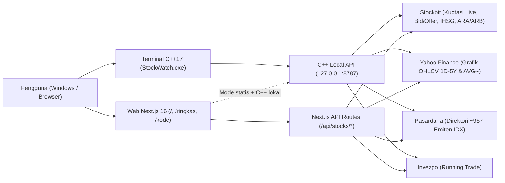
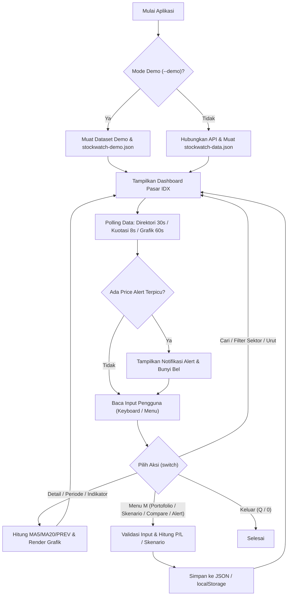

# StockWatch — IDX Terminal & Web Monitor

**StockWatch** adalah aplikasi pemantau pasar saham Bursa Efek Indonesia (IDX) dan IHSG berbasis **terminal konsol C++17** yang dilengkapi **server API lokal** serta **antarmuka web Next.js 16**. Pengguna dapat mencari seluruh emiten IDX, memantau kuotasi harga, menyimpan *watchlist*, melihat grafik *candlestick* multi-periode, memantau *Running Trade*, serta menghitung untung/rugi dan simulasi skenario portofolio.

---

## Identitas Penugasan

Proyek ini disusun untuk memenuhi penugasan mata kuliah **Pengantar Teknologi Informasi (PTI)**.

| Keterangan | Detail |
|---|---|
| **Nama** | Muhammad Tier Sinyo Cahyo Utomo Suharjo |
| **NIM** | `21113032610047` |
| **Program Studi** | Teknik Elektro |
| **Universitas** | Universitas Sebelas Maret (UNS) |
| **Mata Kuliah** | Pengantar Teknologi Informasi (PTI) |

---

## Fitur Utama

- **Dashboard Pasar IDX (~957 emiten)**: Menampilkan daftar emiten IDX, ringkasan pasar (naik, turun, tetap, total nilai transaksi), pencarian real-time berdasarkan kode/nama/sektor, **filter per sektor IDX (`F`)**, pengurutan menurut kode, kenaikan, penurunan, atau nilai transaksi, serta **badge status jam bursa BEI** (`BUKA` / `ISTIRAHAT` / `TUTUP` + sisa waktu).
- **Kuotasi Saham & IHSG**: Menampilkan harga terakhir, perubahan harian (`Rp` & `%`), indikator arah perubahan (`↑`/`↓`), `BUKA`, `HIGH`, `LOW`, `PREV`, `VOL`, `NILAI`, `AVG` / `AVG~`, `BID` / `OFFER`, papan pencatatan, serta estimasi batas auto-rejection (`ARA*` / `ARB*`) sesuai regulasi BEI.
- **Grafik Candlestick 8 Periode + Indikator Teknikal**: Mendukung rentang **1D** (1 menit), **5D** (15 menit), **1M**, **3M**, **6M**, **YTD**, **1Y** (harian), dan **5Y** (mingguan) lengkap dengan bar volume serta toggle indikator **MA5**, **MA20**, **PREV**, dan **AVG** (`T` di terminal / tombol pill di web).
- **Watchlist Live Multi-Saham & Bandingkan Emiten**: Menyimpan hingga 8 saham di *watchlist* dengan pembaruan kuotasi live serentak lewat `/stocks/compare`, serta fitur **Bandingkan Saham** (Menu `11` di C++/Terminal Asli & Tab `6` di Ringkas) untuk membandingkan hingga 8 emiten berdampingan.
- **Portofolio & Simulasi Skenario**: Menghitung nilai modal, nilai berjalan, P/L portofolio (1 lot = 100 lembar), serta simulasi skenario persentase perubahan harga — tersedia baik di menu teks (`M`) maupun secara visual interaktif pada Tab **`5 Portofolio`** di mode Ringkas.
- **Price Alert Lokal**: Memasang target harga naik (`≥`) atau turun (`≤`) pada emiten pilihan (`L` / Menu `12` di terminal, atau form cepat di panel Detail web) dengan notifikasi visual dan bunyi ringan otomatis saat target tersentuh.
- **Running Trade (Tab 4)**: Menampilkan daftar transaksi intraday emiten (waktu WIB, harga, lot, sisi `BUY`/`SELL`, pasar, dan kode broker) melalui Invezgo apabila `INVEZGO_API_KEY` dikonfigurasi.
- **Hemat Sumber Daya & Siap Vercel**: Otomatis menjeda polling saat tab browser tidak aktif (*Page Visibility API*) dan dilengkapi header Edge `Cache-Control` (`s-maxage` + `stale-while-revalidate`).
- **Tiga Mode Antarmuka Web**:
  - **Terminal asli (`/`)**: Layout konsol ala terminal C++ lengkap dengan pintasan keyboard dan tombol sentuh responsif untuk ponsel.
  - **Ringkas (`/ringkas/`)**: Dashboard web modern dengan grafik canvas interaktif, tab Portofolio, dan tab Bandingkan.
  - **Kode C++ (`/kode/`)**: Penampil seluruh kode sumber C++ di folder `src/` dengan *syntax highlighting*, nomor baris, dan tombol salin.

---

## Sumber Data Pasar & Karakteristik Pembaruan

Baik server C++ (`StockWatchApi.exe`) maupun server web Next.js (`/api/stocks/*`) menggunakan pipeline sumber data yang sama:

| Data | Sumber Utama | Fallback | Interval Polling & Cache | Catatan Latensi |
|---|---|---|---|---|
| **Kuotasi saham terpilih** | **Stockbit** (halaman publik) | Yahoo Finance → Pasardana | Poll **8 dtk** saat buka (**30 dtk** saat tutup); cache server 6 dtk | *Near-realtime* (resolusi label waktu per menit; layanan *Live Datafeed* berbayar terpisah) |
| **Kuotasi IHSG (`^JKSE`)** | **Stockbit** (`IHSG`) | Yahoo Finance → `data/ihsg.json` | Poll **8 dtk** saat fokus (**15 dtk** di header, **30 dtk** saat istirahat/tutup) | *Near-realtime* untuk level indeks; `BUKA`/`HIGH`/`LOW` dipadukan dari bar sesi harian Yahoo Finance |
| **Grafik OHLCV & estimasi `AVG~`** | **Yahoo Finance** (`query1`/`query2`) | Snapshot lokal (IHSG & mode statis) | Refresh & cache **60 dtk** | Intraday IDX umumnya memiliki jeda ~10 menit |
| **Direktori ~957 emiten** | **Pasardana** | `quotes.json` → `data/idx-catalog.json` | Poll **30 dtk**; cache server 60 dtk | Snapshot pasar / sesi perdagangan terakhir |
| **Running Trade** | **Invezgo** (opsional) | — | Poll & cache **10 dtk** | Memerlukan paket & `INVEZGO_API_KEY` aktif |

### Catatan Metrik Detail

- **`AVG` & `AVG~`**: `AVG` dihitung dari nilai transaksi dibagi volume lembar dari sumber dan sesi yang sama. Jika nilai transaksi sesi belum tersedia, **`AVG~`** diestimasi menggunakan *Volume-Weighted Typical Price* `(H + L + C) / 3` dari candle 1 menit Yahoo Finance.
- **`ARA*` & `ARB*`**: Estimasi berdasarkan harga acuan `PREV`, papan pencatatan dari Stockbit, dan fraksi harga BEI untuk ketentuan **20 Oktober – 31 Desember 2026** ([Peraturan BEI II-A](https://idx.co.id/Media/stumk2gi/signed_peraturan_nomor_ii_a_tentang_perdagangan_efek_bersifat_ekuitas-261020.pdf) · [Peraturan BEI II-X](https://www.idx.co.id/Media/0dfb0coz/signed_peraturan_ii_x_perdagangan_ebe_pada_papan_pemantauan_khusus.pdf)). Ditampilkan `--` bila aksi korporasi aktif, papan belum diketahui, atau tanggal di luar periode berlaku.

---

## Struktur Proyek

```text
StockWatch/
├── src/                        # Kode sumber C++17 (terminal konsol & server API WinHTTP)
│   ├── terminal.cpp            # Entry point terminal interaktif & menu utilitas
│   ├── dashboard.cpp/.hpp      # Antarmuka TUI dashboard, grafik ASCII/Unicode, Running Trade
│   ├── server.cpp              # HTTP API lokal (127.0.0.1:8787) dengan dukungan CORS
│   ├── market.cpp/.hpp         # Pengambilan data Stockbit, Yahoo Finance, Invezgo, ARA/ARB
│   ├── directory.cpp/.hpp      # Direktori & snapshot Pasardana + fallback katalog lokal
│   ├── portfolio.cpp/.hpp      # Perhitungan modal, P/L, simulasi skenario, format rupiah
│   ├── http.cpp/.hpp           # Klien HTTPS berbasis Windows WinHTTP
│   └── chart_periods.hpp       # Definisi 8 periode grafik (1D – 5Y)
├── third_party/                # Pustaka header-only: cpp-httplib v0.58.0 & nlohmann/json v3.12.0
├── data/                       # Katalog emiten IDX (idx-catalog.json) & snapshot IHSG (ihsg.json)
├── web/                        # Versi web Next.js 16 (App Router + Live API Routes)
│   ├── app/                    # Halaman Terminal Asli (/), Ringkas (/ringkas), Kode (/kode), & API (/api/*)
│   ├── lib/                    # Engine live market server, parser Stockbit, hook client & watchlist
│   ├── public/market/          # Snapshot fallback statis untuk mode offline / GitHub Pages
│   └── scripts/                # Skrip penyegaran snapshot (refresh-market.mjs & refresh-ihsg.mjs)
├── build.bat / run.bat         # Skrip kompilasi MinGW dan eksekusi cepat di Windows
├── StockWatch.workspace       # Workspace proyek Code::Blocks
└── .github/workflows/          # Workflow GitHub Actions untuk ekspor statis GitHub Pages
```

---

## Cara Menjalankan

### 1. Terminal C++ di Windows

**Menggunakan Command Prompt / PowerShell** (memerlukan GCC/MinGW, misalnya dari instalasi Code::Blocks):

```bat
build.bat
run.bat
```

- Gunakan `run.bat --demo` untuk menjalankan mode contoh luring (*offline*) tanpa koneksi internet (6 emiten demo + snapshot IHSG lokal).
- Alternatif melalui **Code::Blocks**: buka `StockWatch.workspace`, pilih proyek **StockWatch**, lalu klik **Build and run**.
- Terminal otomatis menjalankan `StockWatchApi.exe` di `127.0.0.1:8787` di latar belakang dan menutupnya kembali saat aplikasi keluar.

### 2. Versi Web (Next.js 16)

Memerlukan **Node.js 20.9 atau lebih baru**. Jalankan dari folder proyek:

```powershell
cd web
npm ci
npm run dev
```

Buka [http://localhost:3000](http://localhost:3000) di browser. Untuk menjalankan mode produksi lokal:

```powershell
cd web
npm run build
npm start
```

### 3. Mengaktifkan Running Trade (Opsional)

Memerlukan API key [Invezgo](https://docs.invezgo.com/en/api-usage/endpoint/market-data/running-trade/) yang aktif pada paket Running Trade. Set variabel lingkungan di PowerShell sebelum menjalankan terminal C++ atau server web:

```powershell
$env:INVEZGO_API_KEY = [System.Net.NetworkCredential]::new("", (Read-Host "API key Invezgo" -AsSecureString)).Password
# Untuk terminal C++:
.\run.bat
# Atau untuk versi web:
cd web; npm run dev
```

---

## Deployment Web

### Vercel (Direkomendasikan — Mode Live Penuh)

Hosting di **Vercel** mendukung seluruh route server `/api/stocks/*` sehingga data live Stockbit, Yahoo Finance, Pasardana, dan Invezgo bekerja langsung tanpa perlu menjalankan aplikasi C++:

1. Hubungkan repositori GitHub ini ke proyek baru di Vercel.
2. Pada **Settings → General → Root Directory**, isi **`web`** (biarkan `STATIC_EXPORT` kosong agar mode server Next.js aktif).
3. *(Opsional)* Jika ingin mengaktifkan tab Running Trade, tambahkan `INVEZGO_API_KEY` di **Settings → Environment Variables** (tersimpan aman di sisi server, tidak terekspos ke browser).
4. Konfigurasi `web/vercel.json` sudah mengarahkan fungsi serverless ke region **`sin1` (Singapore)** untuk latensi rendah ke sumber data pasar Indonesia, dan seluruh fallback JSON dibundel langsung agar stabil di lingkungan serverless.

### GitHub Pages (Mode Ekspor Statis)

Workflow [.github/workflows/stockwatch-web.yml](.github/workflows/stockwatch-web.yml) membangun ekspor statis (`STATIC_EXPORT=1`, keluaran `web/out`):

1. Di GitHub **Settings → Pages**, pilih **GitHub Actions** sebagai sumber.
2. Jalankan workflow **Deploy StockWatch Web** atau *push* perubahan ke branch utama.
3. Pada mode statis, browser otomatis mencoba menghubungi API C++ lokal (`http://127.0.0.1:8787`) bila sedang aktif di komputer pengguna, lalu mencoba kuotasi publik Stockbit, dan jatuh kembali ke snapshot yang dibangun saat workflow (`npm run data:market` & `npm run data:ihsg`).

---

## Pintasan Keyboard & Simulasi Portofolio

### Pintasan Dashboard

| Tombol | Aksi |
|---|---|
| `1` / `2` / `3` / `4` | Pindah ke tab **Pasar**, **Watchlist**, **Detail**, atau **Running Trade** (`W` juga membuka Watchlist; di `/ringkas/` tersedia pula `5` **Portofolio** dan `6` **Bandingkan**) |
| `/` | Cari emiten berdasarkan kode, nama, atau sektor (`Enter` terapkan, `Esc` batal / hapus filter) |
| `F` | Filter daftar emiten berdasarkan **sektor IDX** (`Semua` → tiap sektor) |
| `↑` / `↓` | Pilih instrumen (tetap aktif di panel Detail) |
| `Page Up` / `Page Down` / `Home` / `End` | Navigasi per halaman atau lompat ke awal/akhir daftar |
| `Enter` / `Esc` | Buka Detail dari tabel / kembali dari Detail atau Running Trade |
| `I` | Langsung membuka detail & grafik **IHSG** |
| `S` | Ganti urutan daftar (`Kode`, `Naik`, `Turun`, `Nilai`) |
| `A` | Tambah atau hapus emiten terpilih dari **Watchlist** (maksimal 8 saham) |
| `T` | Ganti indikator grafik (`Off` → `MA5` → `MA20` → `PREV`) |
| `L` | Pasang atau hapus **Price Alert** cepat untuk emiten terpilih (`>harga` atau `<harga`) |
| `P` / `H` | `P` membuka pemilih periode `1–8`; `H` menggeser ke periode grafik berikutnya |
| `R` / `Space` | `R` memuat ulang data segera; `Space` menjeda atau melanjutkan pembaruan otomatis |
| `M` / `Q` | `M` membuka menu utilitas (`1–12`, termasuk **11 Bandingkan** & **12 Price Alert**); `Q` mengakhiri sesi terminal |

### Contoh Alur Demo Simulasi Portofolio

1. Jalankan `run.bat --demo` (atau buka web), lalu tekan **`M`** untuk masuk ke menu utilitas.
2. Pilih menu **`1`** untuk mencari `Telkom`, lalu ketik `TLKM` untuk melihat kuotasi (menu **`2`** dapat langsung mengecek harga berdasarkan kode).
3. Tambahkan `BBCA` dan `TLKM` ke *watchlist* melalui menu **`4`**, lalu cek hasilnya pada menu **`3`**.
4. Tambahkan posisi portofolio pada menu **`6`**: `BBCA` sebanyak **2 lot** di harga beli **Rp9.800**, lalu `TLKM` sebanyak **4 lot** di harga beli **Rp2.550**.
5. Cek P/L berjalan di menu **`8`**, lalu jalankan simulasi skenario di menu **`9`** (misalnya `-5` untuk `BBCA` dan `2` untuk `TLKM`). Pada dataset demo, nilai skenario menjadi **Rp2.920.000** dari **Rp3.000.000** dengan dampak **−Rp80.000 (−2,67%)**.
6. Pilih menu **`10`** untuk kembali ke dashboard utama.

*(1 lot = 100 lembar saham; simulasi mengabaikan biaya broker, dividen, dan pembulatan fraksi harga. Di terminal C++, data tersimpan pada `stockwatch-data.json` / `stockwatch-demo.json`; di web tersimpan pada `localStorage` browser.)*

---

## Referensi Endpoint API

Endpoint berikut tersedia pada server C++ (`http://127.0.0.1:8787/...`) dan server Next.js (`/api/...`):

| Endpoint | Deskripsi |
|---|---|
| `GET /health` | Status kesehatan & mode server API |
| `GET /stocks/directory` | Direktori & snapshot kuotasi seluruh emiten IDX dari Pasardana |
| `GET /stocks/search?q=telkom` | Pencarian emiten IDX berdasarkan kode atau nama *(C++ API)* |
| `GET /stocks/BBCA` | Kuotasi live saham atau `IHSG` (Stockbit → Yahoo Finance → Pasardana) |
| `GET /stocks/BBCA/history?range=1mo` | Data candle OHLCV (`1d`, `5d`, `1mo`, `3mo`, `6mo`, `ytd`, `1y`, `5y`), sesi harian, dan estimasi `AVG~` |
| `GET /stocks/BBCA/trades` | Transaksi *Running Trade* hari ini dari Invezgo |
| `GET /stocks/compare?codes=BBCA,TLKM` | Perbandingan hingga 8 emiten diurutkan berdasarkan perubahan harian *(C++ API & Next.js API)* |

Contoh uji via terminal:

```bat
curl.exe http://127.0.0.1:8787/stocks/BBCA
```

---

## Kaitan dengan Materi Pengantar Teknologi Informasi (Materi 12–14)

- **Struktur Kontrol (`switch` & Percabangan)**: `src/terminal.cpp` dan `src/dashboard.cpp` menggunakan `switch` untuk navigasi menu (`0–12`) & pintasan tombol, serta percabangan `if/else` untuk validasi kode saham, lot, harga beli, kondisi *price alert*, dan status pasar.
- **Perulangan (*Looping*)**: Digunakan untuk memfilter daftar emiten/sektor, merender tabel pasar, menghitung *Moving Average* (`MA5`/`MA20`) dan agregasi OHLCV grafik, serta mengevaluasi setiap posisi portofolio dan *price alert*.
- **Modularisasi & Struktur Data**: `src/portfolio.cpp` memisahkan rumus nilai posisi, simulasi skenario, persistensi JSON, dan format mata uang rupiah ke fungsi-fungsi terpisah. Dataset demo menggunakan larik statis (`constexpr Sample samples[]` di `src/market.cpp`), sedangkan daftar emiten, *watchlist*, posisi, dan *price alert* menggunakan `std::vector` dan `std::map`.
- **Arsitektur Klien–Server & Diagram Alur (*Flowchart*)**:

### Diagram Arsitektur Klien–Server



### Flowchart Alur Program (Materi 12–14)



---

## Dependensi & Catatan

- **C++17**: [cpp-httplib v0.58.0](https://github.com/yhirose/cpp-httplib/tree/v0.58.0) dan [nlohmann/json v3.12.0](https://github.com/nlohmann/json/tree/v3.12.0) (lisensi tersedia di folder `third_party/`), serta Windows **WinHTTP** untuk koneksi HTTPS.
- **Web**: Next.js 16.4.6, React 19.3.1, IBM Plex Mono, dan Shiki 4.6.0.
- **Disclaimer**: Proyek ini dibuat untuk tujuan **pembelajaran dan penugasan akademik**. Data pasar diambil dari sumber publik pihak ketiga ([Pasardana](https://pasardana.id/), Stockbit, Yahoo Finance, dan Invezgo) dan bukan merupakan rekomendasi investasi maupun umpan data resmi Bursa Efek Indonesia ([Daftar Saham BEI](https://www.idx.co.id/id/data-pasar/data-saham/daftar-saham)).
